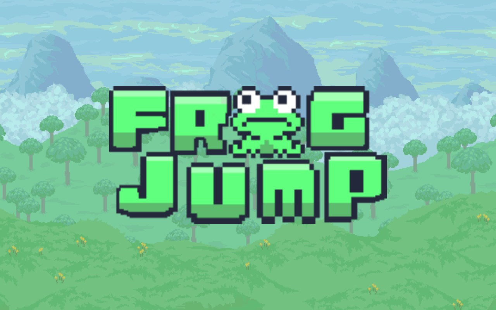

# FrogJump

A 2D platformer built in Java (Swing). Collect every apple, avoid the spikes, and climb to the top of each level.

**▶ Play in your browser: https://gabbogs.github.io/FrogJump/**

## Controls

| Key | Action |
| --- | --- |
| `Enter` or click **Play** | Start |
| `A` / `D` | Move left / right |
| `W` / `Space` | Jump |
| `Esc` | Pause |

## How it works

- **Levels are images.** Each level in `res/lvls/` is a small PNG where every pixel's color tells the game what to place: the red channel picks the terrain tile, blue marks apples and spikes, and green marks the player's spawn point.
- **Game loop:** fixed update rate (200 updates/s) with separate rendering (120 FPS on desktop, 60 in the browser), in `main/Game.java`. Due updates run in a batch each frame, so game speed stays the same even when frames are slow.
- **States:** menu, playing, pause, game over, and level complete, each handled by its own overlay class in `gamestates/` and `ui/`.

## Run it

**In the browser:** the game in `docs/` runs through [CheerpJ](https://cheerpj.com/), which runs the original Java program in the browser with WebAssembly. The page fills the browser window and switches to fullscreen on the first click. Passing `--web` gives a borderless window that scales the game to fit the page and follows it when the size changes. To keep it smooth in the browser, `--web` mode draws each frame at half resolution and scales it up (the pixel art is drawn at 2× or more, so nothing is lost), pre-renders each level's terrain once, and skips drawing anything off-screen. Add `--perf` to print updates and frames per second.

**On the desktop:** open the project in Eclipse (or any Java IDE) with `src` and `res` as source folders, then run `main.MainClass`. Java 8 or newer.

## Team and credits

FrogJump was a course project built by a team of five. I designed the game's UI screens (main menu, pause, game over, and level complete) and the Level 2 map, which I drew pixel by pixel in GIMP.

For the web version I moved levels and sounds into the classpath so the game runs from a JAR, added the browser mode and its performance work, compressed the background music (mono, 24 kHz) and loaded it in the background so it never delays the game, and replaced a copyrighted sound effect with an original one.

Character, terrain, and fruit art: [Pixel Adventure](https://pixelfrog-assets.itch.io/pixel-adventure-1) by Pixel Frog.

## Author

**Gabriel C. Bognot**: [GitHub](https://github.com/gabbogs) · [LinkedIn](https://www.linkedin.com/in/gabbogs/)
